# ML Capstone

This repository contains the Machine Learning Capstone project for course 23CSE301. It covers the regression, classification and clustering tracks on three datasets: the RT-IoT2022 network traffic dataset for predicting flow duration, the UCI Dry Bean dataset for classifying bean varieties, and the Hotel Booking Demand dataset for clustering bookings. In every pipeline the scalers and encoders are fitted on the training data only, hyperparameters are tuned with cross-validation on the training set, and the models are scored on a held-out test set.

## Project Structure

```
ML_Capstone/
├── assets/
│   ├── classification_decision_tree_architecture.png
│   ├── classification_feature_relationships.png
│   ├── classification_knn_tuning_curve.png
│   ├── classification_model_comparison.png
│   ├── classification_naive_bayes_distribution.png
│   ├── classification_roc_curves.png
│   ├── classification_target_distribution.png
│   ├── regression_baseline_comparison.png
│   ├── regression_cross_validation_dashboard.png
│   ├── regression_feature_importance.png
│   ├── regression_final_model_ranking.png
│   ├── regression_flow_duration_distribution.png
│   └── regression_hyperparameter_tuning_impact.png
├── classification/
│   ├── classification_preprocessing.ipynb
│   └── classification.ipynb
├── clustering/
│   └── clustering.ipynb
├── data/
│   ├── hotel_bookings.csv
│   ├── Dry_Bean_Dataset.csv
│   ├── RT_IOT2022
│   └── RT_IOT2022_cleaned.csv
├── regression/
│   ├── regression_preprocessing.ipynb
│   ├── regression.ipynb
│   └── regression_split_indices.json
├── README.md
└── requirements.txt
```

## Datasets

* **Regression Dataset**: `RT_IOT2022_cleaned.csv` (RT-IoT2022 network traffic dataset), containing 117,922 cleaned records and 83 network attributes derived from real-world IoT device traffic.
* **Classification Dataset**: `Dry_Bean_Dataset.csv` (UCI Dry Bean Dataset), containing 13,543 cleaned records and 17 morphological features extracted from high-resolution seed images across 7 dry bean varieties.

## Regression Track

The regression track models continuous network flow duration (`flow_duration` in seconds) using the RT-IoT2022 dataset. Raw network traffic consisting of 123,117 rows and 85 columns was cleaned to 117,922 rows. To eliminate data leakage, 30 temporal, inter-arrival time (IAT), active/idle duration, and packet rate features were removed. One engineered feature, `total_packets` (`fwd_pkts_tot + bwd_pkts_tot`), was introduced. The dataset was partitioned into an 80% training set (94,337 rows) and a 20% held-out test set (23,585 rows), with categorical variables (`proto`, `service`) one-hot encoded to 64 total feature predictors.

The Decision Tree Regressor achieved the best overall performance on the held-out test set, reaching an **$R^2$ of 0.6210**, **RMSE of 36.12 s**, and **MAE of 1.32 s**.

### Output Visualizations

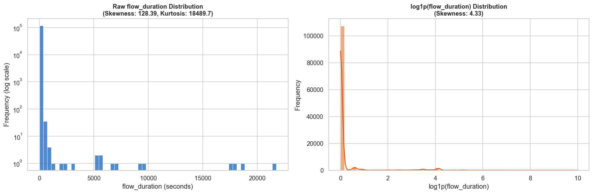  
*Target Distribution: Raw vs. Log1p Transformed flow_duration on training data.*

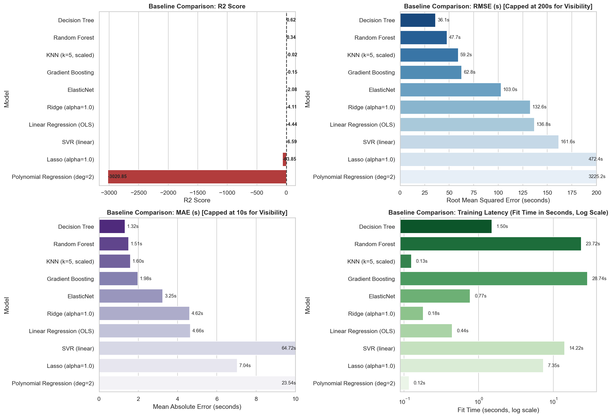  
*4-panel baseline model comparison across R², RMSE, MAE, and training latency.*

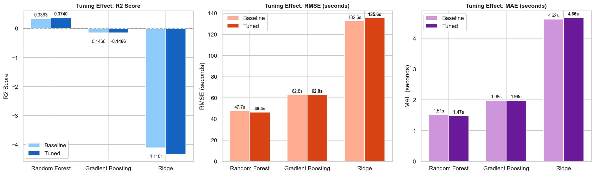  
*Hyperparameter tuning impact across R², RMSE, and MAE for Random Forest, Gradient Boosting, and Ridge.*

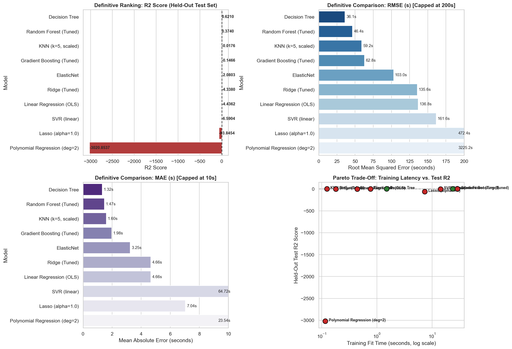  
*Final model ranking and fit-time trade-off across all 10 evaluated regression algorithms.*

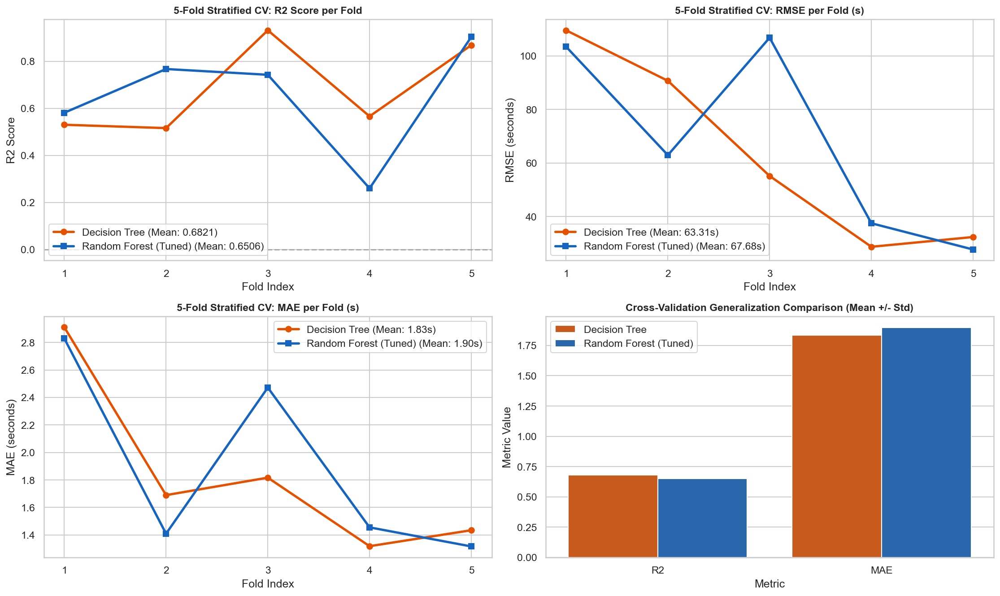  
*5-Fold Stratified Cross-Validation dashboard comparing Decision Tree and Random Forest (Tuned).*

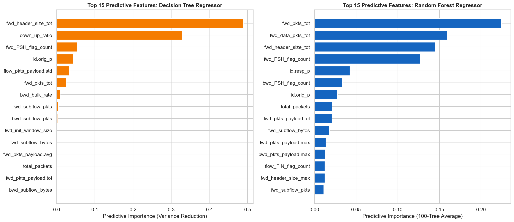  
*Top 15 predictive feature importances extracted from Decision Tree and Random Forest Regressors.*

### Implemented Regression Algorithms & Results

Test-set results for all 10 regression algorithms (23,585 held-out rows):

| Model | Test $R^2$ | Test RMSE (s) | Test MAE (s) | Fit Time (s) | Status |
|---|---|---|---|---|---|
| Decision Tree | 0.621046 | 36.116686 | 1.324463 | 1.910068 | Baseline |
| Random Forest (Tuned) | 0.373990 | 46.420050 | 1.472612 | 24.378544 | Tuned |
| KNN ($k=5$, scaled) | -0.017559 | 59.182686 | 1.603483 | 0.120974 | Baseline |
| Gradient Boosting (Tuned) | -0.146636 | 62.824299 | 1.975976 | 44.683826 | Tuned |
| ElasticNet ($\alpha=1.0, l_1=0.5$) | -2.080283 | 102.969862 | 3.247794 | 0.801898 | Baseline |
| Ridge (Tuned) | -4.338002 | 135.551470 | 4.662105 | 0.363927 | Tuned |
| Linear Regression (OLS) | -4.436240 | 136.793096 | 4.655164 | 0.395646 | Baseline |
| SVR (linear, $C=1.0$) | -6.590373 | 161.639094 | 64.717792 | 22.479963 | Baseline |
| Lasso ($\alpha=1.0$) | -63.845366 | 472.448333 | 7.038223 | 10.456096 | Baseline |
| Polynomial Regression (deg=2) | -3020.853740 | 3225.162260 | 23.537741 | 0.217461 | Baseline |

### Hyperparameter Tuning Comparison

For algorithms subjected to 5-fold cross-validated grid search tuning on `X_train`, the baseline vs. tuned metrics on the held-out test set are detailed below:

| Model | Best Parameters (CV) | Best CV $R^2$ | Baseline Test $R^2$ | Tuned Test $R^2$ | $R^2$ Change | Baseline RMSE (s) | Tuned RMSE (s) | Baseline MAE (s) | Tuned MAE (s) |
|---|---|---|---|---|---|---|---|---|---|
| Random Forest Regressor | `{'max_depth': 25, 'n_estimators': 100}` | 0.7512 | 0.3383 | 0.3740 | +0.0357 | 47.7241 | 46.4201 | 1.5114 | 1.4726 |
| Gradient Boosting Regressor | `{'learning_rate': 0.1}` | 0.6607 | -0.1466 | -0.1466 | +0.0000 | 62.8243 | 62.8243 | 1.9760 | 1.9760 |
| Ridge Regression | `{'alpha': 0.1}` | 0.2501 | -4.1101 | -4.3380 | -0.2279 | 132.6261 | 135.5515 | 4.6168 | 4.6621 |

### 5-Fold Stratified Cross-Validation Breakdown

Cross-validation metrics for the top two regression models, computed on quantile-stratified folds of the training set (`y_train`):

| Model | Fold | $R^2$ | RMSE (s) | MAE (s) |
|---|---|---|---|---|
| Decision Tree (Top 1) | Fold 1 | 0.529901 | 109.551544 | 2.910552 |
| Decision Tree (Top 1) | Fold 2 | 0.515672 | 90.699198 | 1.689703 |
| Decision Tree (Top 1) | Fold 3 | 0.931156 | 55.179252 | 1.816673 |
| Decision Tree (Top 1) | Fold 4 | 0.565770 | 28.737247 | 1.318404 |
| Decision Tree (Top 1) | Fold 5 | 0.868177 | 32.390331 | 1.434421 |
| **Decision Tree Mean $\pm$ Std** | **Mean** | **0.6821 $\pm$ 0.1795** | **63.3115 $\pm$ 31.9558** | **1.8340 $\pm$ 0.5667** |
| Random Forest (Tuned) | Fold 1 | 0.580965 | 103.430655 | 2.828873 |
| Random Forest (Tuned) | Fold 2 | 0.766675 | 62.952632 | 1.409198 |
| Random Forest (Tuned) | Fold 3 | 0.742167 | 106.785129 | 2.471783 |
| Random Forest (Tuned) | Fold 4 | 0.259823 | 37.519132 | 1.455095 |
| Random Forest (Tuned) | Fold 5 | 0.903427 | 27.723536 | 1.316436 |
| **Random Forest Mean $\pm$ Std** | **Mean** | **0.6506 $\pm$ 0.2206** | **67.6822 $\pm$ 32.6676** | **1.8963 $\pm$ 0.6275** |

## Classification Track

The classification track categorizes 7 registered dry bean cultivars using high-resolution image morphometry from `Dry_Bean_Dataset.csv`. Starting with 13,611 raw records, data cleaning removed 68 exact duplicate rows (0.50%), retaining 13,543 cleaned samples across 17 features. No global outlier filter was applied, so large-seeded varieties such as `BOMBAY` were kept. An engineered geometric descriptor, `Area_Perimeter_Ratio` (`Area / Perimeter`), was incorporated. A stratified 80/20 train/test split yielded 10,834 training samples and 2,709 held-out test samples, with `StandardScaler` fitted strictly on `X_train`.

### Final Class Breakdown (13,543 Cleaned Records)

* **DERMASON**: 3,546 samples (26.18%)
* **SIRA**: 2,636 samples (19.46%)
* **SEKER**: 2,027 samples (14.97%)
* **HOROZ**: 1,860 samples (13.73%)
* **CALI**: 1,630 samples (12.04%)
* **BARBUNYA**: 1,322 samples (9.76%)
* **BOMBAY**: 522 samples (3.85%)

The Support Vector Machine (SVC) with an RBF kernel ($C=10$) delivered the highest accuracy on the held-out test set, attaining **92.36% Test Accuracy**, **0.9236 Weighted F1**, **0.9345 Macro F1**, and **0.9931 Multiclass ROC-AUC**.

### Output Visualizations

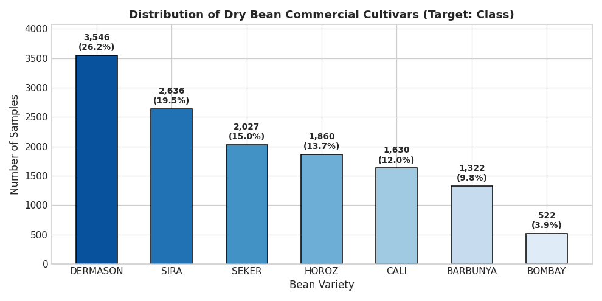  
*Dry Bean class distribution across the 13,543 cleaned dataset records.*

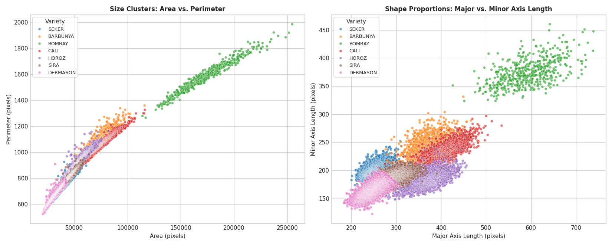  
*Morphological feature relationships: Area vs. Perimeter and Major vs. Minor Axis Length.*

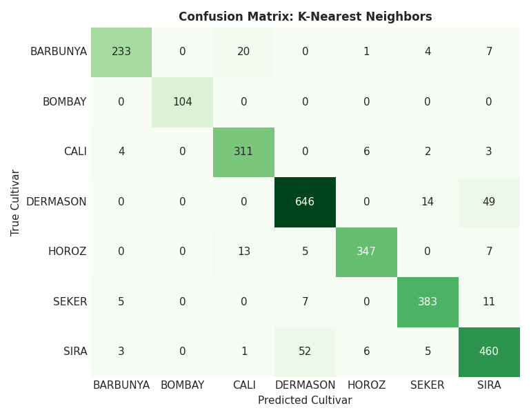  
*K-Nearest Neighbors hyperparameter tuning curve (k vs. Cross-Validation Accuracy).*

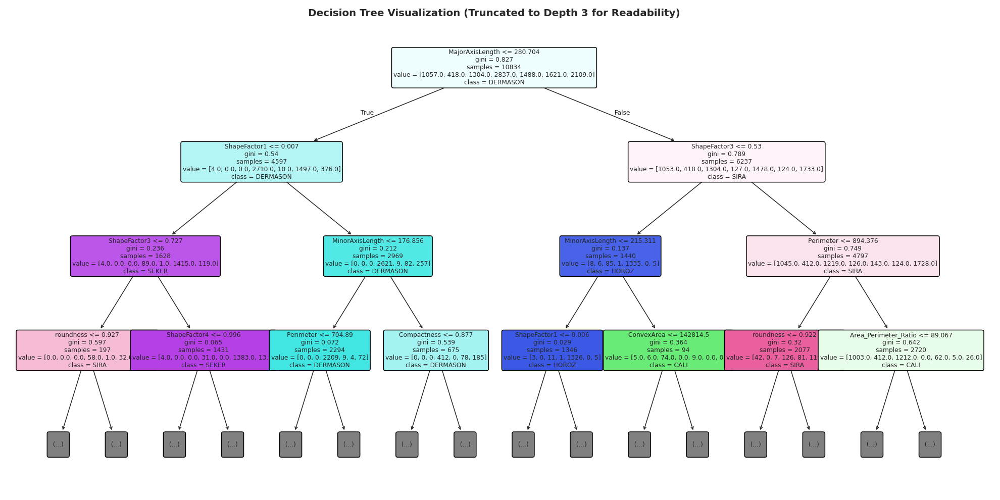  
*Pruned Decision Tree Structural Architecture.*

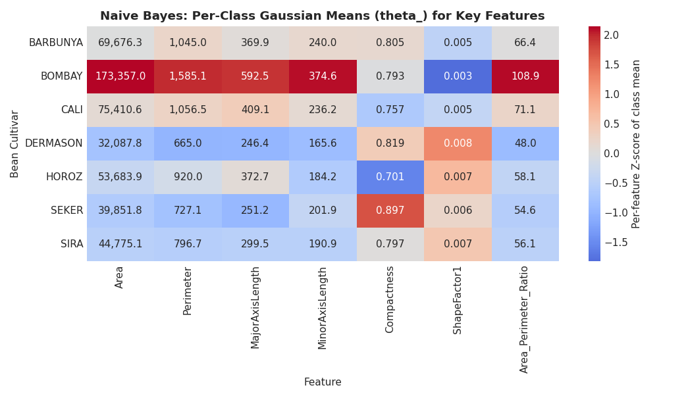  
*Gaussian Naive Bayes class-conditional feature distribution profiles.*

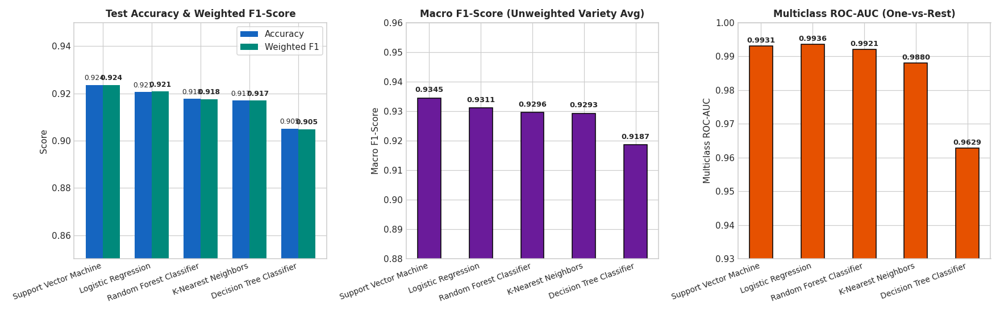  
*Classification benchmark comparison across Accuracy, Weighted F1, Macro F1, and Multiclass ROC-AUC.*

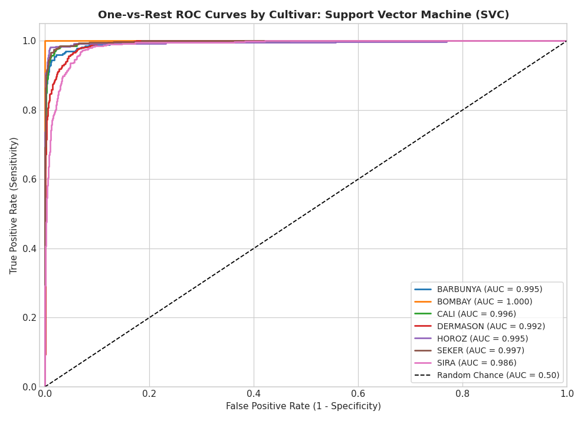  
*Multiclass One-vs-Rest ROC curves for the top-performing Support Vector Machine (SVC).*

### Implemented Classification Algorithms & Results

Test-set results for the five classifiers (2,709 held-out samples):

| Model | Test Accuracy | Weighted Precision | Weighted Recall | Weighted F1 | Macro F1 | ROC-AUC | Training CV Score | Best Parameters (CV) |
|---|---|---|---|---|---|---|---|---|
| Support Vector Machine (SVC) | 0.9236 | 0.9237 | 0.9236 | 0.9236 | 0.9345 | 0.9931 | 0.9322 | `{'C': 10, 'kernel': 'rbf'}` |
| Logistic Regression | 0.9206 | 0.9213 | 0.9206 | 0.9208 | 0.9311 | 0.9936 | 0.9244 | `{'C': 10.0}` |
| K-Nearest Neighbors (KNN) | 0.9169 | 0.9177 | 0.9169 | 0.9171 | 0.9293 | 0.9880 | 0.9232 | `{'n_neighbors': 13}` |
| Decision Tree Classifier | 0.9051 | 0.9051 | 0.9051 | 0.9049 | 0.9187 | 0.9629 | 0.9055 | `{'max_depth': 12, 'min_samples_split': 10}` |
| Naive Bayes (Gaussian) | 0.7545 | 0.7556 | 0.7545 | 0.7521 | 0.7571 | 0.9622 | N/A | `Default (var_smoothing=1e-9)` |

## Clustering Track

The clustering track groups hotel bookings from the Hotel Booking Demand dataset (Antonio, Almeida & Nunes, 2019; `data/hotel_bookings.csv`, 119,390 rows and 32 columns) without using any labels. The outcome columns (`is_canceled`, `reservation_status`, `reservation_status_date`) are excluded from the features and only used afterwards to describe the clusters. After removing duplicates and invalid rows (87,229 left), a random sample of 15,000 bookings was log-transformed, scaled and one-hot encoded into 48 features, and used for both algorithms. Everything is in `clustering/clustering.ipynb`.

| Algorithm | Configuration | Silhouette | Davies-Bouldin | Calinski-Harabasz | Cluster sizes |
|---|---|---|---|---|---|
| K-Means | k=4 | 0.2087 | 1.4673 | 1,469.03 | 1,398 / 12,807 / 624 / 171 |
| Agglomerative | Ward linkage, 4 clusters | 0.4529 | 1.3782 | 1,345.44 | 13,707 / 980 / 171 / 142 |

The elbow curve has no sharp elbow, so k=4 was picked using the silhouette and Davies-Bouldin scores. Both methods give one dominant cluster plus a few small ones, and the three metrics do not agree on a single best method.

## Setup & How to Run

Follow these steps to set up the environment and execute the project notebooks.

### 1. Clone the Repository

```bash
git clone https://github.com/likhith1253/ML_Capstone.git
cd ML_Capstone
```

### 2. Set Up Virtual Environment

```bash
python -m venv venv
# On Windows:
venv\Scripts\activate
# On macOS/Linux:
source venv/bin/activate
```

### 3. Install Dependencies

```bash
pip install -r requirements.txt
```

### 4. Execution Order

Run the notebooks in the following order to ensure data preprocessing pipelines execute before model training and evaluation:

1. **Regression Track**:
   * Run `regression/regression_preprocessing.ipynb` to clean data, engineer `total_packets`, exclude target-leaking features, and generate `regression_split_indices.json`.
   * Run `regression/regression.ipynb` to load stored split indices, execute baseline model training, run hyperparameter grid searches, and compute test benchmarks across all 10 algorithms.
2. **Classification Track**:
   * Run `classification/classification.ipynb` for the Dry Bean EDA, preprocessing, 80/20 stratified split, cross-validated hyperparameter searches, confusion matrices and ROC curves.
3. **Clustering Track**:
   * Run `clustering/clustering.ipynb` for the Hotel Booking Demand EDA, preprocessing, K-Means, Agglomerative clustering, metrics and cluster plots.

## Requirements

Project dependencies are specified in `requirements.txt`. Key packages include:

* `numpy` (>= 1.24.0)
* `pandas` (>= 2.0.0)
* `scikit-learn` (>= 1.2.0)
* `matplotlib` (>= 3.7.0)
* `seaborn` (>= 0.12.0)
* `ipympl` (>= 0.9.0)
* `ipython` (>= 8.0.0)
* `scipy` (>= 1.10.0)

## Team

* **Likhith Ponnada**
* **Prudhvi Manvith**
* **Semanth Parvataneni**

## Highlights

* **Leakage control**: Removed 30 temporal, inter-arrival time (`*iat*`), active/idle duration, and packet rate features from the RT-IoT2022 dataset to prevent data leakage prior to continuous duration modeling.
* **Stratified folds for a continuous target**: Used quantile target binning (`pd.qcut`) on `y_train` to enable 5-fold `StratifiedKFold` cross-validation for a highly right-skewed regression target ($121.03$ skewness).
* **Keeping large bean varieties**: No global IQR filter is applied in the modelling notebook, since it would remove large beans such as `BOMBAY`. `StandardScaler` is fitted on the training split only.
* **Engineered features**: Added `total_packets` (`fwd_pkts_tot + bwd_pkts_tot`) for IoT flow duration and `Area_Perimeter_Ratio` (`Area / Perimeter`) for seed morphometry.
